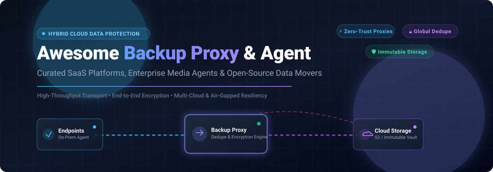

<p align="center">
  
</p>

# 🛡️ Top Hybrid Cloud Backup Proxy & Agent
**A Curated Directory of Enterprise SaaS Platforms, Distributed Media Agents & High-Performance Open-Source Data Movers**

<p align="left">
  <a href="https://github.com/ishandutta2007/Awesome-Awesome-Awesome"></a>
  <a href="https://discord.gg/jc4xtF58Ve"></a>
  
  
  
  <a href="https://github.com/ishandutta2007"></a>
</p>

*Focused on Hybrid Cloud Data Protection, Backup Proxies, Transport Nodes, Media Agents, Endpoint Movers, Distributed Architecture & Immutable Ransomware Recovery.*

**Last updated: November 2026**

---

## 📌 Overview & Architecture

Modern enterprise disaster recovery (DR) and hybrid cloud architectures demand decoupled data movers. **Backup Proxies**, **MediaAgents**, and **Endpoint Agents** serve as vital intermediary pipelines that process, deduplicate, compress, encrypt, and stream backup workloads between on-premises virtual/physical infrastructure and private or hyperscale cloud repositories (Amazon S3, Azure Blob, Google Cloud Storage, Cloudian, Wasabi).

This curated repository tracks the leading **commercial SaaS / enterprise backup solutions** and top **open-source data movers and client-server backup engines**.

---

## 📊 Sector Overview & Market Dynamics

The global cloud backup and hybrid cloud data protection market is valued at approximately **$5.3B–$8.6B** (scaling at a rapid CAGR of ~22%–25%), situated within an expansive overarching hybrid cloud infrastructure sector exceeding **$150B**. 

Market concentration is **moderately concentrated with strong ongoing consolidation** at the enterprise resiliency layer: dominant players (such as Veeam, Cohesity combined with Veritas, Commvault, Rubrik, and Acronis) capture the lion's share of enterprise budgets alongside underlying public hyperscalers, while the mid-market and SMB space remains dynamic and fragmented across specialized point solutions and thousands of Managed Service Providers (MSPs).

---

## 📑 Table of Contents
- [📊 Sector Overview & Market Dynamics](#-sector-overview--market-dynamics)
- [☁️ SaaS & Enterprise Commercial Platforms](#️-saas--enterprise-commercial-platforms)
- [💻 Open-Source GitHub Projects](#-open-source-github-projects)
- [🤝 How to Contribute](#-how-to-contribute)
- [💖 Support & Community](#-support--community)
- [📈 Star History](#-star-history)
- [⚖️ Disclaimer](#️-disclaimer)

---

## ☁️ SaaS & Enterprise Commercial Platforms

*Sorted by company scale (Valuation / Revenue) in descending order:*

| Product | Company Scale (Valuation / Revenue) | Description | Starting Price | Free Tier / Trial Limits |
| :--- | :--- | :--- | :--- | :--- |
| **[Veeam Backup Proxy](https://www.veeam.com/)** | **~$15B valuation** (~$1.7B–$2B ARR) | Core transport mover in Veeam Backup & Replication handling deduplication, compression, and transport to cloud/local repositories. | Starting at ~$95/workload/year (Veeam Data Platform Essentials 5-pack bundle at ~$428/year) | Free forever Community Edition up to 10 workloads; 30-day full-featured enterprise trial |
| **[Cohesity Cloud Edition / Agents](https://www.cohesity.com/)** | **~$7B–$8B valuation** (~$1.3B–$1.7B pro forma rev) | Enterprise hybrid cloud components and agents orchestrating secondary storage, immutable snapshots, and cloud vaulting. | Starting at ~$29,100/year for baseline BaaS packages (~10 BETB entry commitment on AWS Marketplace) | 30-day free trial for Backup-as-a-Service (DataProtect) |
| **[Rubrik Edge](https://www.rubrik.com/)** | **~$7B–$9B market cap** (~$1.09B ARR) | Lightweight software appliance extending zero-trust data security, immutable backups, and proxy transport to edge environments. | Starting at ~$3.80/user/month for cloud apps; enterprise platform contracts typically start around ~$50,000/year | 30-day free trial for specific SaaS modules (e.g., Salesforce); custom PoC/demo for core Edge platform |
| **[Commvault MediaAgent](https://www.commvault.com/)** | **~$5B–$7B market cap** (~$1B+ annual rev) | High-performance data mover and index coordinator managing cross-environment data traffic between clients and targets. | Starting at ~$1.70/user/month for SaaS apps; ~$58.50/TB/month for file/object workloads (~$98/VM/year) | 30-day free trial with full SaaS platform access (or 30,000 trial credits on hyperscaler marketplaces) |
| **[Datto Endpoint Backup Agent](https://www.datto.com/)** | **$6.2B acquisition** by Kaseya (~$619M rev) | Direct-to-cloud endpoint agent protecting mobile, remote, and server workloads with automated cloud verification. | Starting at ~$105/month for packaged DR configurations (or ~$2–$6/endpoint/month via MSP tiers) | Free partner NFR evaluation licenses (2 free NFR PC licenses for registered partners); guided trial spin/demo for prospects |
| **[Quest Rapid Recovery Core](https://www.quest.com/)** | **$5.4B acquisition** (~$700M–$850M rev) | Core deduplication, snapshot, and hybrid replication engine connecting on-prem systems with cloud repositories. | Starting at ~$1,819.99/license (includes 1 year of 24x7 support & maintenance) | 14-day free trial (extendable by administrators up to 28–30 days) |
| **[Acronis Backup Agent](https://www.acronis.com/)** | **~$3.5B valuation** (~$400M–$430M rev) | Cyber Protect universal workload agent delivering unified anti-ransomware, disk cloning, and hybrid cloud archiving. | Starting at ~$85/workstation/year and ~$595/server/year | 30-day full-featured free trial |
| **[Druva Backup Proxy](https://www.druva.com/)** | **~$1B–$2B valuation** (~$200M–$300M ARR) | 100% SaaS cloud proxy appliance that streams deduplicated on-prem workload snapshots into Druva AWS Cloud. | Starting at ~$8.00/user/month (or consumption-based per TB post-dedup) | 30-day free trial (no credit card required, full functionality across evaluation workloads) |
| **[Arcserve UDP Agent / Proxy](https://www.arcserve.com/)** | **~$100M–$150M est. rev** (PE-backed) | Unified Data Protection proxies delivering block-level I/O tracking, WAN optimization, and multi-tenant cloud storage. | Starting at ~$19.99/front-end TB/month (or annual software subscriptions from ~$1,300/year) | Free forever Workstation Free Edition (after trial); 30-day full-featured free trial |
| **[NAKIVO Transporter](https://www.nakivo.com/)** | **~$20M–$30M est. rev** (Bootstrapped/Private) | Lightweight data mover service responsible for backup execution, network throttling, and repository writing. | Starting at ~$2.45/workload/month (or perpetual licenses from ~$229/socket) | Free forever Edition for up to 10 workloads + 5 M365 users; 15-day unconstrained full trial |

---

## 💻 Open-Source GitHub Projects

*Sorted by GitHub Stars_Count in descending order. Stars_Badges link directly to each project's stargazers community:*

- **[Rclone](https://github.com/rclone/rclone)** [](https://github.com/rclone/rclone/stargazers)  
  🚀 The "Swiss army knife" for cloud storage. Syncs directories and files across 70+ cloud storage backends (S3, B2, Azure, Google Drive, SFTP, WebDAV); frequently acts as the lightweight data mover layer in custom hybrid pipelines.

- **[Restic](https://github.com/restic/restic)** [](https://github.com/restic/restic/stargazers)  
  ⚡ Fast, secure, and authenticated backup program written in Go. Employs state-of-the-art cryptography and content-defined chunking (CDC) deduplication, targeting S3, SFTP, and REST backends.

- **[Duplicati](https://github.com/duplicati/duplicati)** [](https://github.com/duplicati/duplicati/stargazers)  
  🌐 Free backup client featuring a clean web UI. Handles incremental block-level deduplication, AES-256 encryption, and hybrid uploads across standard cloud storage targets.

- **[Kopia](https://github.com/kopia/kopia)** [](https://github.com/kopia/kopia/stargazers)  
  🔒 Fast and secure open-source backup tool featuring both CLI and GUI interfaces. Supports zero-knowledge client-side encryption, deduplication, content caching, and native cloud repository providers.

- **[BorgBackup](https://github.com/borgbackup/borg)** [](https://github.com/borgbackup/borg/stargazers)  
  📦 Deduplicating archiver with authenticated encryption and compression. Ideal for automated, high-efficiency server-to-server and server-to-cloud backup pipelines over SSH.

- **[Velero](https://github.com/velero-io/velero)** [](https://github.com/velero-io/velero/stargazers)  
  ☸️ Industry-standard cloud-native data protection platform for Kubernetes. Backs up and restores cluster resources and persistent volumes across hybrid cloud and multicloud environments.

- **[Bup](https://github.com/bup/bup)** [](https://github.com/bup/bup/stargazers)  
  🗄️ Highly efficient backup system based on the Git packfile format. Handles massive virtual machine disk images and multi-terabyte datasets through rolling-checksum global deduplication.

- **[Duplicacy](https://github.com/gilbertchen/duplicacy)** [](https://github.com/gilbertchen/duplicacy/stargazers)  
  🔄 Lock-free deduplicating cloud backup tool. Enables multiple clients and agents to back up concurrently to the same active cloud storage destination without requiring an active coordinator daemon.

- **[WAL-G](https://github.com/wal-g/wal-g)** [](https://github.com/wal-g/wal-g/stargazers)  
  🐘 Advanced archival, continuous WAL streamer, and point-in-time recovery data mover for PostgreSQL, MySQL, and SQL Server pushing straight to cloud object storage.

- **[Rustic](https://github.com/rustic-rs/rustic)** [](https://github.com/rustic-rs/rustic/stargazers)  
  🦀 High-performance, memory-safe backup client powered by Rust. Restic-compatible repository format with advanced pruning, synthetic full backups, and extensible backend drivers.

- **[Barman](https://github.com/EnterpriseDB/barman)** [](https://github.com/EnterpriseDB/barman/stargazers)  
  🏛️ Enterprise-grade Backup and Recovery Manager for PostgreSQL. Coordinates remote agents, streaming replication, WAL archiving, and cloud retention policies.

- **[Bareos](https://github.com/bareos/bareos)** [](https://github.com/bareos/bareos/stargazers)  
  🏢 Enterprise-grade open-source network backup engine (Director, Storage Daemon, File Daemon). The premier self-hosted equivalent to commercial media agent / proxy topologies; supports tape, disk, and S3-compatible cloud storage.

- **[UrBackup](https://github.com/uroni/urbackup_backend)** [](https://github.com/uroni/urbackup_backend/stargazers)  
  🖥️ Open-source client/server backup system for Windows and Linux. Offers fast image and file backups with web administration, client agent autodiscovery, and offsite storage replication.

- **[Amanda](https://github.com/zmanda/amanda)** [](https://github.com/zmanda/amanda/stargazers)  
  🕰️ Advanced Maryland Automatic Network Disk Archiver. Battle-tested client-server backup framework capable of coordinating hundreds of endpoint agents to centralized storage pools and cloud tiers.

- **[Proxmox Backup Server](https://github.com/proxmox/proxmox-backup)** [](https://github.com/proxmox/proxmox-backup/stargazers)  
  🛡️ Enterprise backup solution architected in Rust, tailored for Proxmox VE VMs, containers, and physical hosts. Features deduplication, authenticated zstd compression, client encryption, and remote synchronization.

- **[Bacula Community](https://github.com/bacula-web/bacula-web)** [](https://github.com/bacula-web/bacula-web/stargazers)  
  🌐 Classic distributed enterprise backup suite (Director, Storage Daemon, File Daemon). Provides industrial scheduling, granular catalogs, and multi-node protection for hybrid infrastructure *(GitHub Stars_Badge tracks the Bacula-Web management portal; core engine source hosted at [Bacula Community GitLab](https://gitlab.bacula.org/))*.

---

## 🛠️ Hybrid Cloud Architecture Cheat Sheet

```
+-------------------------------------------------------------+
|                     On-Premises Workload                    |
|   [VMware / Hyper-V / Proxmox / Bare-Metal / K8s Nodes]    |
+-------------------------------------------------------------+
                              │
                              ▼
        +---------------------------------------------+
        |     Local Agent / Proxy / MediaAgent        |
        |  - In-flight Compression & Deduplication    |
        |  - AES-256 Client-Side Encryption          |
        |  - WAN Throttling & Network Optimization    |
        +---------------------------------------------+
                              │
          ┌───────────────────┴───────────────────┐
          ▼                                       ▼
+---------------------+               +-----------------------+
| Local Fast Recovery |               | Multi-Cloud Object    |
| (NAS / SAN / PBBA)  |               | (S3 / Azure / Wasabi) |
+---------------------+               +-----------------------+
```

---

## 🤝 How to Contribute
1. 🍴 Fork the repository.
2. 📝 Add or update entries in `README.md` (keep descriptions factual, concise, and include official links).
3. 🧪 Verify that all links, badges, and pricing metrics are active and accurate.
4. 🚀 Submit a Pull Request with a clear explanation of your additions.

---

## 💖 Support & Community

If you find this curated directory helpful for your infrastructure planning or hybrid data protection architecture:
- ⭐ **Star this repository** to show your support and make it easier for others to discover!
- 🍴 **Fork it** to maintain your own internal bookmarks or submit improvements.
- 📣 **Share it** with fellow DevOps engineers, sysadmins, and cloud architects.
- ☕ **Sponsor the Maintainer:** If this saved you hours of procurement research or architecture design, consider supporting the work via the [GitHub Sponsor Dashboard](https://github.com/sponsors/ishandutta2007)!

---

## 📈 Star History

[](https://www.star-history.com/#ishandutta2007/Awesome-Hybrid-Cloud-Backup-Proxy-Agent&type=date&legend=top-left)

---

## ⚖️ Disclaimer
- This repository is a **community-curated reference** and is not affiliated with, endorsed by, or sponsored by any of the included commercial vendors or foundations.
- Backup, disaster recovery, and data protection form critical infrastructure layers. Always test and validate recovery objectives (RTO/RPO), audit immutable storage locks, and verify disaster recovery drills before relying on any solution in production.

---
<p align="center">
  <b>Built with ❤️ for backup administrators, infrastructure architects, and open-source practitioners.</b>
</p>
